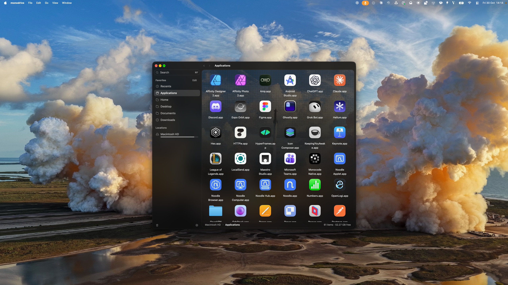

<p align="center">
  
</p>

<h1 align="center">Monodrive</h1>

<p align="center">
  <strong>A Rust + GPUI file manager for you and your agents.</strong>
</p>

<p align="center">
  
</p>

A fast file manager for macOS heavily inspired by [Monocode](https://github.com/hardbeat920/monocode), built with [GPUI](https://www.gpui.rs) and searching the whole disk through [fsearch](https://github.com/noahdunnagan/fsearch). It also runs as an MCP server, so coding agents search your files through the same index instead of Spotlight.

> [!NOTE]
> **[Monodrive](https://github.com/donnes/monodrive/releases)** is still experimental and supports only macOS for now.

Focused fixes are welcome. Read [CONTRIBUTING.md](CONTRIBUTING.md) before opening a PR, and report vulnerabilities through [SECURITY.md](SECURITY.md).

## Run

```sh
cargo run -p monodrive              # the window, on your home folder
cargo run -p monodrive -- ~/Work    # another folder
cargo run -p monodrive -- mcp       # the MCP server on stdio
```

The search field has focus when the window opens, and ⌘F returns to it. ↑ and ↓ move the selection, Enter opens it, Escape clears the search, and ⌘[ / ⌘] / ⌘↑ go back, forward and up.

To use it from Claude Code:

```sh
cargo build -p monodrive
claude mcp add monodrive -- "$PWD/target/debug/monodrive" mcp
```

On a Mac without an fsearch index, opening the window or running the first MCP search crawls the whole disk in the background, which takes a few minutes. The index lives in `~/Library/Application Support/FSearch` and is shared with the fsearch CLI. Grant Full Disk Access to the binary to index protected folders.

## Develop

`scripts/check` runs the same checks as CI. See [AGENTS.md](AGENTS.md) for how we work and [CONTRIBUTING.md](CONTRIBUTING.md) before opening a PR.

Monodrive is MIT licensed; see [LICENSE](LICENSE). Credits for the code and assets it builds on are in [NOTICE](NOTICE).
